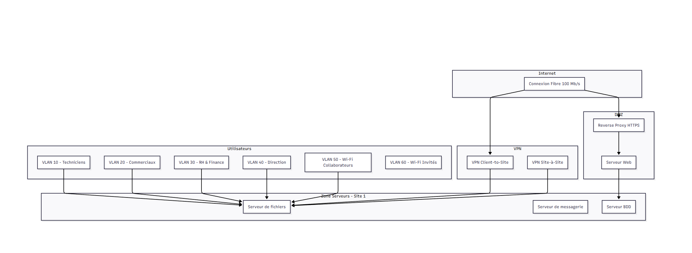

# Dossier d'architecture technique — réseau sécurisé multi-sites

> Projet ETNA — Dossier d'Architecture Technique (DAT)

Conception de l'architecture réseau et sécurité d'une **PME aéronautique, sous-traitante d'Airbus**, répartie sur deux sites de 50 utilisateurs, avec un serveur web exposé et des exigences de conformité renforcées (collaboration possible avec des entités militaires).

📄 **[Lire le DAT complet (PDF, 25 pages)](DAT.pdf)**

**Compétences mises en œuvre :** analyse de risques · segmentation VLAN / 802.1Q · 802.1X & FreeRADIUS · VPN IPsec (strongSwan) · filtrage inter-VLAN (iptables) · DMZ & reverse proxy Nginx · portail captif pfSense · supervision Zabbix · PRA & sauvegardes · référentiels ANSSI, ISO 27001, RGPD, HDS, AirCyber

---



## Démarche

1. **Étude de risques** — inventaire des actifs sensibles, menaces physiques, réseau, applicatives et humaines, mesures de réduction associées.
2. **Architecture cible** — schémas logique et physique, plan d'adressage, segmentation, interconnexion des sites.
3. **Préconisations de sécurité** — accès LAN et Wi-Fi, nomades, DMZ, journalisation et alerting, sauvegarde et continuité.
4. **Exemples d'implémentation** — configurations concrètes prêtes à adapter.

## Segmentation proposée

| VLAN | Usage | Site | Réseau |
|---|---|---|---|
| 10 | Technique | 1 | 10.1.10.0/24 |
| 20 | Commercial | 1 | 10.1.20.0/24 |
| 30 | RH & Finance | 2 | 10.2.30.0/24 |
| 40 | Direction | 2 | 10.2.40.0/24 |
| 50 | Wi-Fi collaborateurs | 1 / 2 | 10.1.50.0/24 · 10.2.50.0/24 |
| 60 | Wi-Fi invités (Internet uniquement, isolé) | 1 / 2 | 10.1.60.0/24 · 10.2.60.0/24 |
| 99 | DMZ (serveur web) | 1 | 10.1.99.0/24 |
| 100 | Serveurs internes | 1 | 10.1.100.0/24 |
| 200 | VPN nomades (MFA) | 1 | 10.1.200.0/24 |

Switchs : trunks 802.1Q, port security, authentification 802.1X via RADIUS, QoS pour les flux critiques.

## Exemples d'implémentation inclus

| Sujet | Schéma |
|---|---|
| VPN IPsec site-à-site (strongSwan) | [IPsec_site-a-site.png](schemas/IPsec_site-a-site.png) |
| Règles de pare-feu inter-VLAN (iptables) | [ACL_inter-VLAN.png](schemas/ACL_inter-VLAN.png) |
| Authentification 802.1X (FreeRADIUS) | [Authentification_802.1X.png](schemas/Authentification_802.1X.png) |
| Portail captif Wi-Fi invité (pfSense) | [Wi-Fi_invite.png](schemas/Wi-Fi_invite.png) |
| Reverse proxy HTTPS (Nginx) | [Reverse_proxy_HTTPS.png](schemas/Reverse_proxy_HTTPS.png) |
| Sécurisation du serveur web | [Securisation_serveur_web.png](schemas/Securisation_serveur_web.png) |
| Supervision (Zabbix) | voir DAT § 5.6 |

Autres schémas : [physique](schemas/Schema_physique.png) · [interconnexion des sites](schemas/Interconnexion_des_sites.png) · [schéma draw.io final](schemas/Schema_final.drawio.html).

## Contenu du dépôt

```
DAT.pdf    dossier complet (version de lecture)
DAT.docx   source éditable
schemas/   schémas réseau et diagrammes d'implémentation
```
